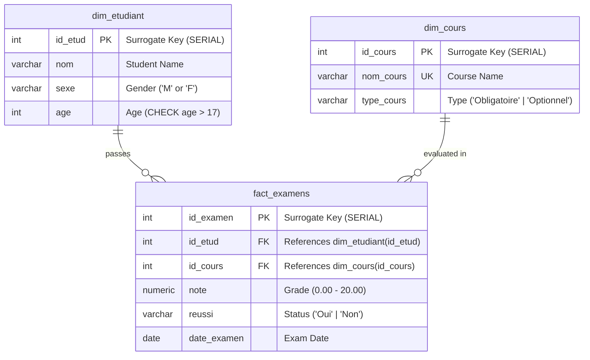
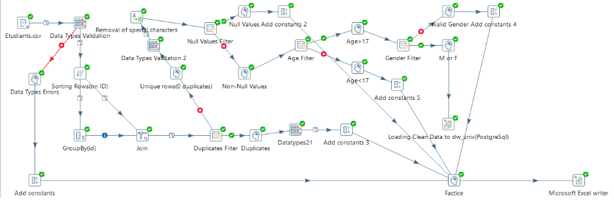
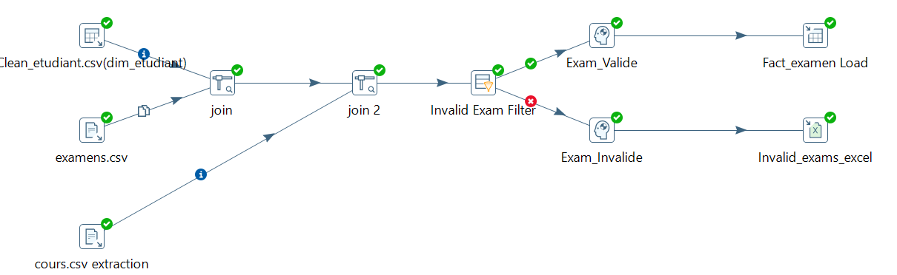
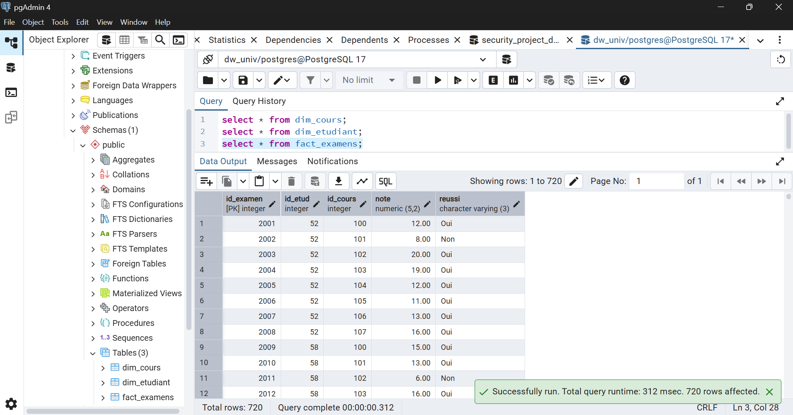
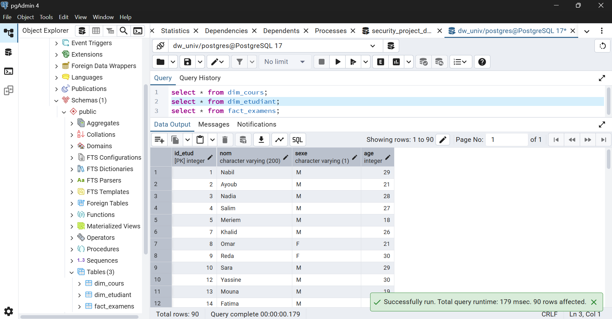
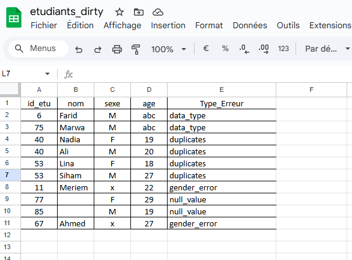

# 🎓 University Mini Data Warehouse & ETL Pipeline (Pentaho PDI)

[](https://www.hitachivantara.com/en-us/products/data-management-analytics/pentaho.html)
[](https://www.postgresql.org/)
[](https://www.pgadmin.org/)
[](#)
[](https://ensa-tetouan.ac.ma/)

> An end-to-end Data Warehousing and ETL engineering project implementing a Star Schema in **PostgreSQL** using **Pentaho Data Integration (PDI / Kettle)**. Features advanced cascading data cleaning, regex text sanitization, non-destructive audit deduplication, referential integrity lookups, and unified error tracking.

---

## 📌 Table of Contents

- [Overview](#-overview)
- [Architecture & Data Model](#-architecture--data-model)
  - [Star Schema](#star-schema)
  - [PostgreSQL Schema & Constraints](#postgresql-schema--constraints)
- [ETL Pipeline Implementation](#-etl-pipeline-implementation)
  - [Pipeline 1: Student Data Cleansing (`dim_etudiant`)](#1-student-data-cleansing--validation-dim_etudiant)
  - [Pipeline 2: Course Dimension Loading (`dim_cours`)](#2-course-catalog-normalization-dim_cours)
  - [Pipeline 3: Exam Facts & Referential Integrity (`fact_examens`)](#3-exam-fact-loading--referential-integrity-fact_examens)
- [Key Engineering Challenges & Solutions](#-key-engineering-challenges--solutions)
- [Validation & Verification](#-validation--verification)
- [Repository Structure](#-repository-structure)
- [Getting Started](#-getting-started)
- [Author & Acknowledgments](#-author--acknowledgments)

---

## 📖 Overview

In academic and enterprise decision-support systems, raw data extracted from operational systems frequently suffers from data quality anomalies: duplicates, malformed types, invalid domain values, and broken referential integrity.

This project delivers a complete business intelligence pipeline:
- **Source**: Raw, heterogeneous CSV files (`etudiants.csv`, `cours.csv`, `examens.csv`).
- **ETL Engine**: **Pentaho Data Integration (Spoon)** with modular transformations.
- **Target**: PostgreSQL relational Data Warehouse (`dw_univ`) modeled as a **Star Schema**.
- **Audit System**: Centralized error capture directing anomalous rows to Excel audit logs (`etudiants_dirty.xlsx`) with precise categorization labels.

---

## 🏛️ Architecture & Data Model

### Star Schema

The warehouse is built on a dimensional Star Schema designed for analytical reporting on academic exam performances:



### PostgreSQL Schema & Constraints

Data integrity is reinforced at the database level with strict domain and referential constraints:
- **`CHECK (age > 17)`**: Disallows records failing university admission age thresholds.
- **`CHECK (sexe IN ('M','F'))`**: Guarantees standardized gender taxonomy.
- **`CHECK (type_cours IN ('Obligatoire','Optionnel'))`**: Enforces course categories.
- **`FOREIGN KEY` on `fact_examens`**: Prevents orphaned fact rows that lack valid dimension entries.

The DDL scripts are provided in [`SQL/dw_univ_schema.sql`](SQL/dw_univ_schema.sql) and [`SQL/Scripts_SQL_TP_BI.sql`](SQL/Scripts_SQL_TP_BI.sql).

---

## ⚙️ ETL Pipeline Implementation

The ETL workflows are divided into three modular Kettle transformations (`.ktr`) located in the [`ETL/`](ETL/) folder:

### 1. Student Data Cleansing & Validation (`dim_etudiant`)

File: [`ETL/1st Transformation.ktr`](ETL/1st%20Transformation.ktr)

This transformation is the core data quality engine. It processes raw student data through a sequential, non-destructive cascading pipeline:



#### Step-by-Step Processing:
1. **Extraction & Type Validation**:
   - `Etudiants.csv` read via `CsvInput`.
   - `Data Types Validation` checks numeric/string conformance. Failing records are immediately routed to `Data Types Errors`.
2. **Regex Text Sanitization**:
   - `Removal of special characters` applies regular expressions to strip extraneous characters from names.
3. **Non-Destructive Deduplication**:
   - Rather than silently discarding rows with the naive `Unique Rows` step, rows are sorted (`Sorting Rows(on ID)`) and aggregated (`GroupBy(id)`) to calculate ID frequency counts.
   - Rows with `count > 1` are captured into an audit trail rather than arbitrarily lost.
4. **Cascading Quality Filters**:
   - **`Null Values Filter`**: Discards rows with missing mandatory fields.
   - **`Age Filter`**: Validates legal adult status (`age > 17`).
   - **`Gender Filter`**: Restricts gender entries strictly to `'M'` or `'F'`.
5. **Loading Clean Dimension Data**:
   - Valid records are loaded into PostgreSQL via `Insert / Update` step (`dim_etudiant`).

---

### 2. Course Catalog Normalization (`dim_cours`)

File: [`ETL/2nd Transformation.ktr`](ETL/2nd%20Transformation.ktr)

- **Input**: `cours.csv`
- **Validation**: Enforces course names and categories (`Obligatoire` vs. `Optionnel`).
- **Load**: Upserted into PostgreSQL table `dim_cours` with natural key lookup on `nom_cours`.

---

### 3. Exam Fact Loading & Referential Integrity (`fact_examens`)

File: [`ETL/3rd Transformation.ktr`](ETL/3rd%20Transformation.ktr)

To preserve referential integrity, exam facts are validated against both loaded dimensions before ingestion into `fact_examens`:



#### Lookups & Integrity Checks:
1. **Student Dimension Lookup**: `StreamLookup` / `Merge Join (INNER)` matches exam student IDs against verified students.
2. **Course Dimension Lookup**: Secondary lookup verifies the associated course exists.
3. **Rejection Filtering**: If either student or course foreign key is unresolvable, the record is flagged by `Invalid Exam Filter` and redirected to an Excel audit file.
4. **Fact Ingestion**: Clean, verified transactions are inserted into PostgreSQL `fact_examens`.

---

## 💡 Key Engineering Challenges & Solutions

### 1. File Lock Conflicts in Multi-Stream Audit Exports
* **Problem**: When multiple error rejection branches attempted to write to the same audit Excel file (`etudiants_dirty.xlsx`) simultaneously, Pentaho crashed due to OS file lock conflicts. Generating separate spreadsheets per error type fragmented auditing.
* **Solution**: An architectural redesign using Pentaho's metadata injection pattern:
  - Each rejection branch passes through an **`Add Constants`** step defining a descriptive `Type_Erreur` column (e.g., `data_type`, `duplicates`, `null_value`, `gender_error`).
  - All streams converge into a single **`Factice` (Dummy)** union step.
  - A single, centralized **`Microsoft Excel writer`** processes the unified stream, producing a structured, consolidated audit log.

### 2. Non-Destructive Deduplication Strategy
* **Problem**: The standard `Unique Rows` component removes duplicate rows arbitrarily without preserving trace history.
* **Solution**: Built an audit-first deduplication flow using `Sort Rows` $\rightarrow$ `Group By (count)` $\rightarrow$ `Filter Rows (count > 1)`. All duplicates are directed to the error file for human auditing, ensuring full audit compliance.

---

## 📊 Validation & Verification

### PostgreSQL Warehouse Verification (pgAdmin 4)

Querying the loaded PostgreSQL database confirms successful, constraint-compliant ingestion:

#### `fact_examens` (720 validated records loaded):


#### `dim_etudiant` (90 validated students loaded):


#### Centralized Error Audit (`etudiants_dirty.xlsx`):
All non-conforming rows captured with precise error tags:


---

## 📁 Repository Structure

```plaintext
Pentaho-PDI-ETL-Pipeline/
│
├── assets/                               # Architecture diagrams & verification screenshots
│   ├── flow1.png                         # Dimension etudiant ETL pipeline canvas
│   ├── pipeline_dim_etudiant.png         # Student pipeline overview
│   ├── pipeline_fact_examens.png         # Exam fact loading pipeline
│   ├── db_dim_etudiant_verification.png  # pgAdmin query on dim_etudiant
│   ├── db_fact_examens_verification.png  # pgAdmin query on fact_examens
│   └── audit_rejected_records.png        # Audit log sheet with tagged error types
│
├── docs/                                 # Documentation & academic reports
│   └── Rapport_Travail_Pratique_Pentaho.pdf # Complete project report (ENSA Tétouan)
│
├── Errors_File/                          # Error audit outputs generated by ETL
│   └── etudiants_dirty.xlsx              # Consolidated rejected rows with error reasons
│
├── ETL/                                  # Pentaho Data Integration transformations (.ktr)
│   ├── 1st Transformation.ktr            # Student cleansing, cascading filters & audit writer
│   ├── 2nd Transformation.ktr            # Course dimension loading & normalization
│   └── 3rd Transformation.ktr            # Exam fact lookup & referential integrity loading
│
├── SQL/                                  # PostgreSQL DDL & DML scripts
│   ├── dw_univ_schema.sql                # Enhanced DDL with indexes & analytical KPI queries
│   └── Scripts_SQL_TP_BI.sql             # Original database creation script
│
├── .gitignore                            # Git ignore rules for PDI, OS, and IDE files
├── flow1.png                             # Pipeline canvas overview
└── README.md                             # Project documentation
```

---

## 🚀 Getting Started

### Prerequisites
- **Java JRE/JDK 8 or 11+**
- **Pentaho Data Integration (PDI / Spoon) 8.x or 9.x+**
- **PostgreSQL 12+**
- **PostgreSQL JDBC Driver** placed in Pentaho's `lib/` directory (`postgresql-42.x.x.jar`)

### 1. Database Setup
1. Launch PostgreSQL and create the database:
   ```bash
   psql -U postgres -c "CREATE DATABASE dw_univ;"
   ```
2. Execute the schema script:
   ```bash
   psql -U postgres -d dw_univ -f SQL/dw_univ_schema.sql
   ```

### 2. Configure Database Connection in Spoon
In Pentaho Spoon:
- **Connection Name**: `dw_univ`
- **Connection Type**: `PostgreSQL`
- **Host**: `localhost`
- **Database**: `dw_univ`
- **Port**: `5432`
- Test connection to verify credentials.

### 3. Run Transformations in Order
Open and execute the transformations sequentially in Spoon:
1. `ETL/1st Transformation.ktr` (Populates `dim_etudiant` & outputs `Errors_File/etudiants_dirty.xlsx`)
2. `ETL/2nd Transformation.ktr` (Populates `dim_cours`)
3. `ETL/3rd Transformation.ktr` (Populates `fact_examens`)

---

## 👨‍💻 Author & Acknowledgments

- **Author**: **Yassir Adila**
- **Program**: Big Data, Data Science & Artificial Intelligence (BDIA2)
- **Institution**: **École Nationale des Sciences Appliquées de Tétouan (ENSA Tétouan)**
- **Supervision**: **Pr. Nisrine EL AYAT**
- **Academic Year**: 2025 – 2026

---

*If you found this project helpful, consider starring ⭐ the repository!*
